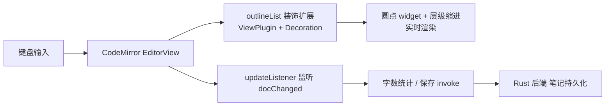

## 用户需求

在速记界面与历史编辑界面，输入框中输入 `- / * / + `（后接空格）时，实时将该行渲染为幕布式嵌套圆点列表（所见即所得、光标与选区正常），无需保存即可看到效果；代码结构需预留接口，便于后续平滑扩展其他 Markdown 元素（标题、粗体等）。

## 产品概述

用 CodeMirror 6 替换两个界面的原生 `textarea`，采用源码式即时预览（Live Preview）模式：文本仍以纯文本存储与编辑，仅把列表标记原地绘制为圆点并按缩进体现层级。保留现有全部交互行为：Tab 缩进、Enter 继承缩进、Ctrl+Enter 保存、Esc 收起/取消、F11 全屏、字数统计、自动保存。

## 核心特性

- 输入 `- / * / + ` 即时渲染为蓝色圆点列表项（光标/选区原生不变）
- 按行首缩进宽度呈现幕布式嵌套层级
- 保留 Tab 缩进与 Enter 续行继承缩进的幕布式编辑手感
- 保留 Ctrl+Enter 保存、Esc 收起/取消、F11 全屏、字数统计

## 技术栈

- 前端：原生 HTML + JavaScript（ESM），无框架（延续现状）
- 编辑器内核：**CodeMirror 6**（`codemirror`、`@codemirror/view`、`@codemirror/state`、`@codemirror/commands`、`@codemirror/language`、`@codemirror/lang-markdown`）
- 构建工具：**Vite**（多页应用，承载 npm 依赖打包）
- 桌面壳：Tauri v2（Rust 后端零改动，仅调整前端构建配置）

## 实现方案

**策略**：引入 Vite 解决 npm 包打包问题；用 CodeMirror 的 `EditorView` 取代 `textarea`，通过 `ViewPlugin` + `Decoration` 在源码文本之上叠加「圆点 widget + 层级缩进」装饰，实现源码式即时预览。底层仍是纯文本（`view.state.doc.toString()`），保存/读取逻辑与现有笔记存储完全兼容。

**关键技术决策**：

1. **为什么 CodeMirror 而非 contenteditable / 自写 overlay**：原生 `textarea` 无法内嵌 widget，自写 overlay 需逐字符像素对齐且 IME/长行易抖动；CodeMirror 的 Decoration 机制是业界（Obsidian Live Preview）验证过的「源码 + 装饰」方案，光标/选区由内核管理，零回归风险。
2. **为什么加 Vite**：项目当前无打包器，Tauri 直接 serv `src/`；CodeMirror 来自 node_modules，必须经打包。Vite 多页配置可同时服务 index/history/settings 三个 HTML 入口，改动最小。
3. **列表识别复用现有逻辑**：`outline.js` 的 `/^([ \t]*)([-*+])(\s.*|)$/` 与 `history.js` 的 `indentOf/isItem` 判定直接迁移到新扩展，保证行为一致。
4. **交互保留**：Tab 缩进、Enter 继承缩进、Ctrl+Enter 保存、Esc、F11 通过 CodeMirror `keymap` 自定义命令实现（替代原 `textarea` 的 keydown 监听），避免焦点/事件冲突。

**性能与可靠性**：装饰计算为 O(行数) 的线性扫描，仅 `docChanged` 时重算，CodeMirror 用 `RangeSet` 高效增量更新；仅对可见区域参与布局，长文档无压力。圆点 widget 为纯文本节点，开销极低。

## 实现要点

- **移除 overlay 方案**：删除 `src/outline.js`（仅含 `renderOutlineInline`/`syncOutline`）、`index.html` 的 `#note-overlay`、`history.html` 的 `#edit-overlay`，以及两 JS 中的 `syncOutline` import 与 scroll 同步。
- **多页 Vite 配置**：`vite.config.js` 设 `base: './'`，`build.rollupOptions.input` 包含 `index.html`/`history.html`/`settings.html`；`tauri.conf.json` 改 `devPath: "http://localhost:5173"`、`frontendDist: "../dist"`（CSP 当前为 null，无需额外放行）。
- **编辑器集成**：`textarea` 替换为挂载容器 `div`；`main.js`/`history.js` 中以 `createEditor()` 取得 `EditorView`，用 `view.state.doc.toString()` 替代 `textarea.value` 读写，`EditorView.updateListener` 替代 `input` 事件驱动字数统计。
- **历史编辑态**：`edit-view` 内常驻一个 `EditorView`，`enterEdit` 时用 `dispatch` 注入 `note.content` 并聚焦，`saveEdit` 读取文档文本；列表展示用 `renderOutline`（history.js 内部）保持不变。

## 架构设计



## 目录结构

```
Spark/
├── package.json              # [MODIFY] 新增 vite、codemirror 系列依赖；scripts 增加 dev/build
├── vite.config.js            # [NEW] 多页入口(index/history/settings)，base './'
├── src-tauri/tauri.conf.json # [MODIFY] devPath→http://localhost:5173，frontendDist→../dist
├── src/
│   ├── index.html            # [MODIFY] 移除 #note-overlay；#note-input 改为编辑器挂载 div；script 引用改相对路径
│   ├── history.html          # [MODIFY] 移除 #edit-overlay；#edit-text 改为挂载 div；script 引用改相对路径
│   ├── main.js               # [MODIFY] 用 EditorView 替换 textarea 读写/事件/快捷键，移除 syncOutline
│   ├── history.js            # [MODIFY] 编辑态用 EditorView；enterEdit/saveEdit 适配；保留 renderOutline 列表展示
│   ├── outline.js            # [DELETE] overlay 方案废弃，列表逻辑迁移至 src/editor
│   ├── editor/
│   │   ├── index.js          # [NEW] createEditor 工厂：组装 basicSetup + markdown + outlineList + 自定义 keymap
│   │   ├── outlineList.js     # [NEW] 列表即时渲染扩展(ViewPlugin + Decoration)，装饰规则可扩展数组化
│   │   └── theme.js          # [NEW] CodeMirror 主题，匹配现有 Catppuccin Mocha 视觉
│   └── styles.css            # [MODIFY] 新增 .cm-editor 容器与圆点/层级视觉，移除 overlay 与 .bullet 旧样式
```

## 关键代码结构

```js
// src/editor/index.js
export function createEditor(opts: {
  parent: HTMLElement;
  doc?: string;
  placeholder?: string;
  onDocChange?: (text: string) => void;
  commands?: Record<string, (view: EditorView) => boolean>;
}): EditorView;

// src/editor/outlineList.js
// 列表即时渲染扩展：识别 ^([ \t]*)([-*+])(\s.*|)$ 行，
// 用 Decoration.replace 隐藏标记 + Decoration.widget 绘制圆点，
// 按缩进层级加 line decoration（cm-list-item / cm-level-N）。
export function outlineList(): Extension;
```

## 设计风格

延续现有 Catppuccin Mocha 深色极简美学，将原生 textarea 平滑替换为 CodeMirror 编辑器，视觉与原有编辑框保持一致：透明背景、15px 正文、1.7 行高、14/16px 内边距、文本色 #cdd6f4。列表标记 `- / * / + ` 在输入空格后即时变为蓝色圆点（#89b4fa），嵌套层级通过行首缩进宽度与可选虚线引导线体现幕布式结构；光标与选区保持原生，无视觉割裂。整体保持轻量、安静、聚焦的速记氛围。